<!-- Tarjetas SVG animadas generadas por scripts/render_cards.py (tema: terminal)
     y actualizadas diariamente por .github/workflows/update-profile-art.yml.
     Mantén las 3 tarjetas de proyecto en una sola línea sin espacios entre ellas. -->

 
 
 
 

  <a href="https://www.linkedin.com/in/TU-USUARIO-LINKEDIN">LinkedIn</a>

